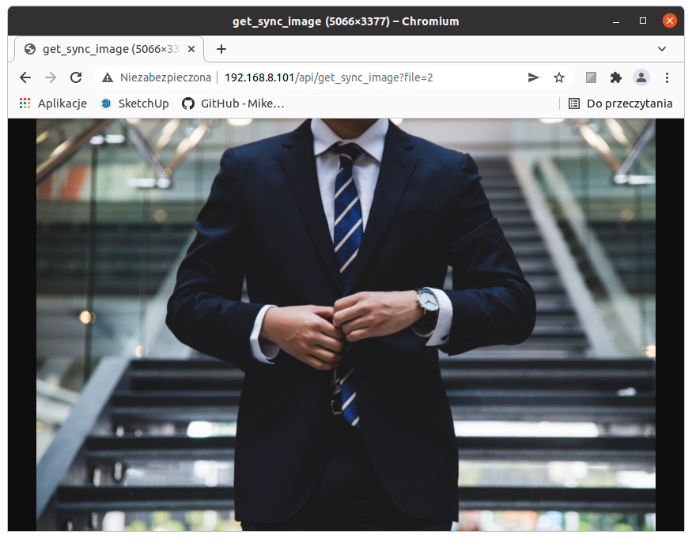
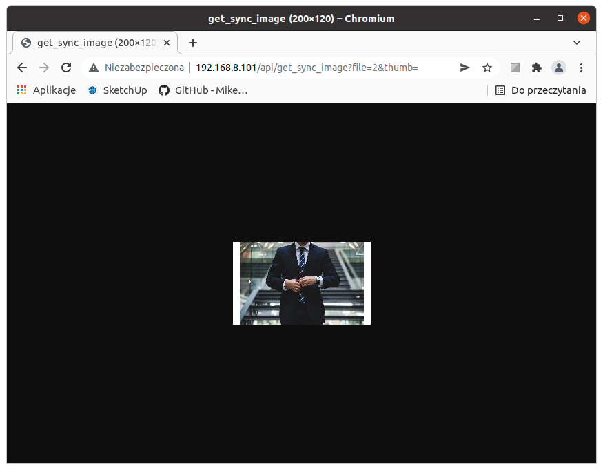
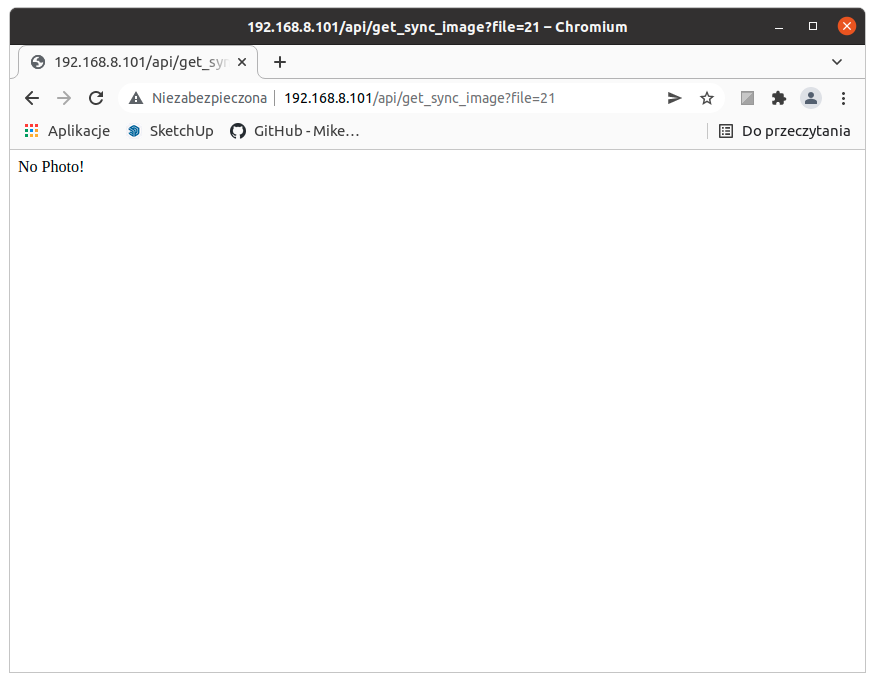
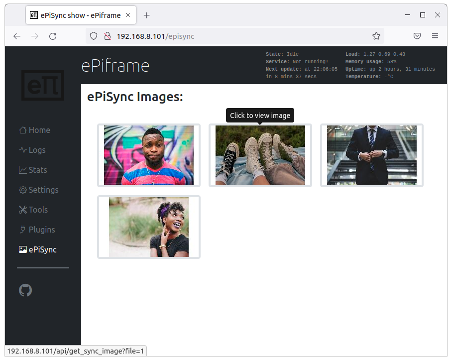
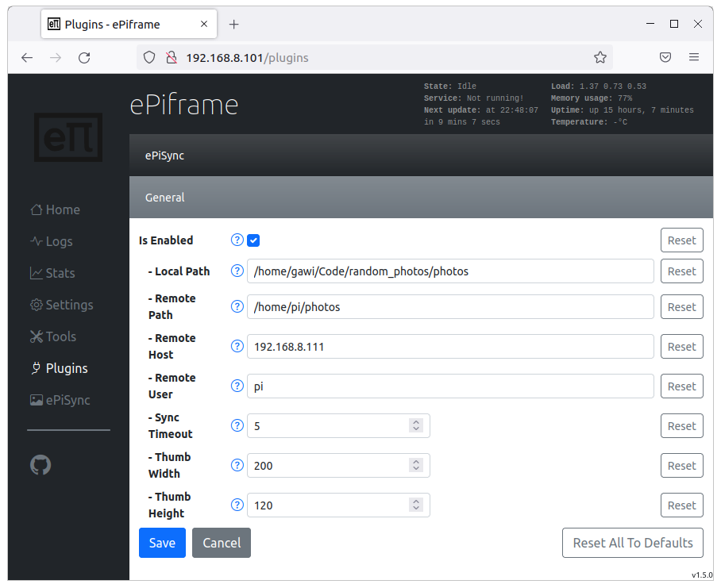

# ePiframe_plugin tutorial

In this tutorial we will gather all steps needed to create a multi-functional ePiframe plugin (Plugin API v2,
ePiframe 2.0). Some functions may seem unnecessary or exaggerated but this is only done for tutorial purposes and to
show how much one plugin can do.

## The plugin

Let's consider a plugin with functions:
* [Step 1: Photo collection](#step-1-photo-collection) - Collect the photos from a remote host with
  [rsync](https://en.wikipedia.org/wiki/Rsync)
* [Step 2: Retrieving the photo](#step-2-retrieving-the-photo) - When a photo from this source (as more can be
  enabled) is chosen, the plugin retrieves its file
* [Step 3: Thumbnails](#step-3-thumbnails) - Synced photos get thumbnails (used by the website in step 6)
* [Step 4: Photo processing](#step-4-photo-processing) - Photos shown from the new source get a watermark
* [Step 5: Extending API](#step-5-extending-api) - The plugin extends the ePiframe API with a method returning a
  thumbnail or the original photo
* [Step 6: Adding website](#step-6-adding-website) - The plugin adds a website to the ePiframe WebUI presenting the
  synced photos (with the API method from step 5)
* [Step 7: Adding configuration](#step-7-adding-configuration) - The plugin has a configuration file, editable in
  the WebUI too, with validated entries to customize its functions

## Prerequisites

Of course, you already have a working ePiframe 2.0, so the most important thing to start with is... the name of
your project. It is really nice to have it before starting anything as it will help with the flow and all the
thoughts will have a name under them. At some point ePiframe had a working name *GoopheePi* (Google Photos ePaper
Pi) but later, after adding new functions I thought that with an e-Paper display it looks *epic,* so it was changed
to *ePiframe*. The only limitation for the name: letters, digits and `_` only (no dots, dashes or spaces) - it is
also the plugin folder name and ePiframe imports the plugin as a Python module.

Let's name this plugin *ePiSync* to stick to the ePiframe name and emphasize the sync function.

### Getting the code

* Start a new project with the GitHub [*ePiframe_plugin*](https://github.com/MikeGawi/ePiframe_plugin) project
  template
* Clone the repository `git clone <plugin URL>` or download and unzip it
* Inside `_plugin.py` fill in the basic data: name, description, author, etc.

Let's put our data:
```python
class Plugin(PluginBase):
    name = "ePiSync"
    author = "ePiframe_plugin tutorial"
    description = (
        "Sync photos with rsync from remote location, generate thumbnails, then add"
        " watermark, API method and a website to view new photos"
    )
    site = "https://github.com/MikeGawi/ePiframe_plugin/blob/master/docs/TUTORIAL.md"
    info = "All steps gathered here to create a multi-functional ePiframe plugin"
```

### Installation of 3rd party components

Next thing is to gather all needed components. Our plugin needs *rsync*. It is a standard component of Raspberry
Pi OS *BUT* it's better to mention it in the plugin requirements and documentation. The rest is already in ePiframe:
Pillow for image processing in Python, ImageMagick for command line image processing and Flask for API and website
related things.

If your plugin needs more, i.e. external APIs, sites, modules, projects - describe in the documentation how to
install/configure them and whether they have limitations or a price.

Python packages that ePiframe doesn't have go to *requirements.txt* in the plugin folder - the user installs them
with `sudo ./install.sh --plugins` (see [Python packages](SETUP.md#python-packages)). ePiSync needs none.

Let's install rsync:
```
sudo apt update
sudo apt install rsync
```

## Implementation

The plugin is installed in the ePiframe *plugins* folder: *<ePiframe path>/plugins/ePiSync*. You can just put it
there to make tests easier, but [stop the service](https://github.com/MikeGawi/ePiframe/blob/master/INSTALL.md#service-control)
first, so you don't interfere with a working frame (or point the `EPIFRAME_PLUGINS_DIR` environment variable to a
test plugins folder).

ePiframe [can be installed](https://github.com/MikeGawi/ePiframe/blob/master/INSTALL.md#manual) also on non-Pi
computers. Run it with the `test` command from the command line, i.e. `epiframe test` - it makes a whole photo
change without the display and the log shows what the plugin did. Running the WebUI and other services is possible
with [other commands](https://github.com/MikeGawi/ePiframe/blob/master/INSTALL.md#command-line).

The plugin base class `epiframe.plugins.base.Plugin` is part of ePiframe and our plugin class inherits from it.
ePiframe calls the plugin methods in different phases of its work - only the ones the plugin overrides. A plugin
uses ePiframe through the `epiframe` package (e.g. `from epiframe.photos.model import Photo`) and its own files as
`plugins.<plugin_folder>.<module>`.

If an error happens in a plugin method and the photo can't be shown correctly, raise an exception - ePiframe logs
it. For optional things (e.g. a network sync) log a warning with `self.logger.warning(...)` and go on.

Let's start with the steps of our plugin.

### Step 1: Photo collection

*Collect the photos from a remote host with [rsync](https://en.wikipedia.org/wiki/Rsync)*

rsync is a utility for efficiently transferring and synchronizing files between a computer and a storage drive and
across networked computers by comparing the modification times and sizes of files. The benefit of using rsync is
that it can skip already existing files and get only the new ones using ssh and standard Unix accounts.

Generic syntax:
```
rsync [OPTION] … [USER@]HOST:SRC [DEST]
```

We need a *HOST* server providing photos under some *SRC* location and a *USER* with access to this source. We
don't want the user to provide a password for the synchronization, as ePiframe should work headlessly. There are
methods to pass the account password ([sshpass](https://www.redhat.com/sysadmin/ssh-automation-sshpass)) but there
is a more elegant solution - SSH keys.

On the frame, so the one that will gather photos from the *HOST*, we generate a public SSH key with no password for
the user that ePiframe works as:
```
ssh-keygen -f ~/.ssh/id_rsa -q -P ""
cat ~/.ssh/id_rsa.pub
```

This is our public SSH key that can be placed on other hosts to give us access:
```
ssh-rsa AAAAB3NzaC1yc2EAAAADAQABAAABAQDLVDBIpdpfePg/a6h8au1HTKPPrg8wuTrjdh0QFVPpTI4KHctf6/FGg1NOgM++hrDlbrDVStKn/b3Mu65//tuvY5SG9sR4vrINCSQF++a+YRTGU6Sn4ltKpyj3usHERvBndtFXoDxsYKRCtPfgm1BGTBpoSl2A7lrwnmVSg+u11FOa1xSZ393aaBFDSeX8GlJf1SojWYIAbE25Xe3z5L232vZ5acC2PJkvKctzvUttJCP91gbNe5FSwDolE44diYbNYqEtvq2Jt8x45YzgFSVKf6ffnPwnUDwhtvc2f317TKx9l2Eq4aWqXTOMiPFA5ZRM/CF0IJCqeXG6s+qVfRjB pi@ePiframe
```

Let's copy this key, log in to the source server (with the *USER* account used for synchronization) and put the key
into the *~/.ssh/authorized_keys* file. If the file doesn't exist, create it:
```
mkdir ~/.ssh
chmod 0700 ~/.ssh
touch ~/.ssh/authorized_keys
chmod 0644 ~/.ssh/authorized_keys
```

Now we can check that we can log in from the frame to the source with SSH (it should not ask for a password):
```
ssh USER@HOST
```

So now we can put together the rsync command gathering the files, best with a timeout and a flag to not overwrite
already existing files. A few seconds with the manual and:
```
rsync --timeout=TIME --ignore-existing USER@HOST:SRC DEST
```

According to the [contribution additional hints](https://github.com/MikeGawi/ePiframe_plugin/blob/master/docs/SETUP.md#additional-hints):

> Allow users to configure as many options of the plugin as possible, e.g. if the plugin puts text somewhere, allow
> the user to pick the position, color, font size, etc.

So these values go to the [plugin configuration](https://github.com/MikeGawi/ePiframe_plugin/blob/master/docs/SETUP.md#creating-configuration),
which validates them and lets the user change them in the WebUI. The entries are described by the plugin `settings()`
method:
```python
from epiframe.config.property import ConfigProperty, PropertyType
from epiframe.sources.local import create_directory


def settings(self) -> list[ConfigProperty]:
    enabled = "is_enabled"  # all entries are used only when the plugin is on
    return [
        *super().settings(),  # is_enabled: required
        ConfigProperty(
            "local_path",
            PropertyType.FILE,
            dependency=enabled,
            convert=create_directory,  # the folder is created if missing
        ),
        ConfigProperty("remote_path", dependency=enabled),
        ConfigProperty("remote_host", dependency=enabled),
        ConfigProperty("remote_user", dependency=enabled),
        ConfigProperty(
            "sync_timeout",
            PropertyType.INTEGER,
            min_value=2,
            max_value=10,
            dependency=enabled,
        ),
        ...
    ]
```

`local_path` (DEST = destination of the photos) is a `FILE` entry: ePiframe checks that the path exists. Here's a
small trick: `convert` is meant to convert old value formats when the file is loaded, but it is called with the value
before the validation, so `create_directory` (from ePiframe's local source) uses it to create the folder if it's
missing - it returns the value unchanged.

The next entries: `remote_path` (SRC = path on the remote host), `remote_host` (HOST = IP or host name of the remote
host) and `remote_user` (USER = user on the remote host) are text entries (the default type) and must not be empty
(the default).

`sync_timeout` is an `INTEGER` with limits: a value outside 2-10 is an error. It is possible to set only one of the
limits too. More possibilities: [configuration entries](https://github.com/MikeGawi/ePiframe_plugin/blob/master/docs/SETUP.md#configuration-entries).

All entries depend on the boolean `is_enabled` entry: they are not validated when the plugin is disabled and are
blocked for changes in the WebUI.

Plugin configuration values are read with `self.config.get(NAME)` for text and `self.config.getint(NAME)` for
numbers.

Now the photo source itself. The method to override is
[`source_photos`](https://github.com/MikeGawi/ePiframe_plugin/blob/master/docs/SETUP.md#adding-photo-source) and it
returns all photos of the source as `Photo(id, self.source, created)` objects: an id identifying the photo (here:
the file path), the source name of this plugin and the creation time (used for sorting and date filters). ePiframe
keeps all photos of all sources in its photo index, which sorts, filters and picks the photo to show.

To list the photo files we can use ePiframe's `LocalSource` - the same code that reads ePiframe's local photo
folder. It recognizes the photo files by `EXTENSIONS` and gives them the file time as the creation time; we only
change their source to ours.

Here's the code:
```python
import dataclasses
import subprocess
from pathlib import Path

from epiframe.core.media_types import EXTENSIONS
from epiframe.photos.model import Photo
from epiframe.sources.local import LocalSource


@property
def local_path(self) -> Path:
    return Path(self.config.get("local_path"))

def source_photos(self) -> list[Photo]:
    self.sync()
    photos = self.synced_photos()
    self.make_thumbnails(photos)  # Step 3: thumbnails of new photos
    return photos

def sync(self) -> None:
    # rsync gets only the files that are not here yet; an argument list (no
    # shell), so values from the configuration can't inject commands
    remote = self.config.get("remote_path").rstrip("/") + "/*"
    command = [
        "rsync",
        f"--timeout={self.config.getint('sync_timeout')}",
        "--ignore-existing",
        f"{self.config.get('remote_user')}@{self.config.get('remote_host')}:{remote}",
        f"{self.local_path}/",
    ]
    result = subprocess.run(command, capture_output=True, text=True, check=False)
    if result.returncode != 0:
        # no network or host down: the photos synced before are still shown
        self.logger.warning(f"rsync failed: {result.stderr.strip()}")

def synced_photos(self) -> list[Photo]:
    # LocalSource lists the photo files (known extensions, sorted); the
    # photos get this plugin's source name
    source = LocalSource(str(self.local_path), False, EXTENSIONS)
    return [dataclasses.replace(p, source=self.source) for p in source.photos()]
```

* the rsync command is a list of arguments taken from the configuration; `subprocess.run` starts it without a shell,
  so a value like `; rm -rf ~` in the configuration is just a wrong host name, not a command
* `remote` gets the files wildcard (`*`) after the remote path (with exactly one `/` before it)
* a failed sync (no network, host down) is only a warning: the photos synced before are still shown
* `LocalSource(...).photos()` lists the synced photo files, `dataclasses.replace` sets our source name

And that's it!

On every frame refresh ePiframe calls `source_photos`: new photos are synced, and the photo index adds the new ones
and drops the removed ones. The photo list is used for sorting, filtering and picking the photo.

### Step 2: Retrieving the photo

*When a photo from this source (as more can be enabled) is chosen, the plugin retrieves its file*

This step may be hard to understand, so let's shine some light on the situation:
* Imagine a photo source in the Web that is slow and has thousands of terabytes of photos
* Downloading this data to a RasPi would kill it
* Such an amount of data needs huge storage attached to the Raspberry Pi
* There may be some limitations of the hosting site that can time out or just hang the process

Problematic, right? Especially when ePiframe works on a Raspberry Pi Zero. So ePiframe gathers only the data of the
photos (id, creation time) from the source and works on that list. When it picks a photo from this source, *only
then* the file is retrieved and processed.

That's how the Google Drive source works: a folder can hold a huge number of photos and only the one to show is
downloaded. For a local source it's different because the photos are already on the storage, and we just copy the one
we want to process and display.

The method to override is
[`fetch_photo`](https://github.com/MikeGawi/ePiframe_plugin/blob/master/docs/SETUP.md#retrieving-the-photo-file).
It gets the picked `photo`, the target `directory` and the file `name` (without extension) and returns the path of
the retrieved file: `directory / (name + "." + extension)`.

In our case the files are already in the local folder, so we need to recognize the file type and copy the file.
Getting the right extension is not that easy (a file name may lie, some sources give only a
[MIME type](https://en.wikipedia.org/wiki/MIME)), so let's ask ImageMagick:
```python
import shutil
from pathlib import Path

from epiframe.core.media_types import MIME_PREFIX, TYPE_TO_EXTENSION
from epiframe.processing.imagemagick import ImageMagick


def fetch_photo(self, photo: Photo, directory: Path, name: str) -> Path:
    magick = ImageMagick(self.global_config.get("convert_bin_path"))
    image_format = magick.image_format(photo.id)  # e.g. "JPEG"
    extension = TYPE_TO_EXTENSION[MIME_PREFIX + image_format.lower()]
    target = directory / f"{name}.{extension}"
    shutil.copy(photo.id, target)
    return target
```

* `self.global_config` is ePiframe's configuration (read only), working like the plugin's `self.config`. Check
  [ePiframe config.cfg](https://github.com/MikeGawi/ePiframe/blob/master/config.cfg) for more entries
* `self.global_config.get("convert_bin_path")` is the configured ImageMagick `convert` tool
* `ImageMagick.image_format` returns the format of the file (of its first frame for GIFs), e.g. `JPEG`
* `MIME_PREFIX + format` makes a MIME type (`image/jpeg`) and `TYPE_TO_EXTENSION` maps it to an extension
* `photo.id` is the synced file path (we set it in [step 1](#step-1-photo-collection))
* the file is copied to `target`, whose path is returned

**_❗ IMPORTANT ❗_** This method is called ONLY for photos whose source is this plugin's `self.source`.

**_❗ IMPORTANT ❗_** Without this method ePiframe does exactly the same for a photo whose id is a local file, so in
the case of this plugin it is redundant - it's here to show the method.

### Step 3: Thumbnails

*Synced photos get thumbnails (used by the website in step 6)*

Just to remind:

> ePiframe works only on the list of photos information not on files as it would be resource consuming. The only
> file that it works on is the one that is processed and displayed on the frame.

In ePiframe 1.x plugins could change the whole collected photo list (`change_photos_list`). ePiframe 2.0 doesn't load
the whole list anymore - a library can have hundreds of thousands of photos, so sorting, filtering and picking are
done in its photo index. Work on the photos of a plugin belongs to the plugin's own methods - so our thumbnails are
made right after the sync, in `source_photos` ([step 1](#step-1-photo-collection)).

ImageMagick makes a thumbnail of the same size from a photo of any size with:
```
convert <input_photo> -background white -gravity center -sample <width>x<height> -extent <width>x<height> <output_photo>
```

Width and height go to the configuration for user customization:
```python
ConfigProperty(
    "thumb_width",
    PropertyType.INTEGER,
    min_value=100,
    max_value=400,
    dependency=enabled,
),
ConfigProperty(
    "thumb_height",
    PropertyType.INTEGER,
    min_value=100,
    max_value=300,
    dependency=enabled,
),
```

* `thumb_width` and `thumb_height` are integers with minimum and maximum, used only when the plugin is enabled

The code:
```python
from epiframe.processing.imagemagick import ImageMagick, ImageMagickError

THUMBS_DIR = "thumbs"  # inside local_path
THUMB_PREFIX = "thumb_"


def thumbnail(self, photo_path: str) -> Path:
    path = Path(photo_path)
    return path.parent / THUMBS_DIR / f"{THUMB_PREFIX}{path.name}"

def make_thumbnails(self, photos: list[Photo]) -> None:
    size = f"{self.config.get('thumb_width')}x{self.config.get('thumb_height')}"
    magick = ImageMagick(self.global_config.get("convert_bin_path"))
    (self.local_path / THUMBS_DIR).mkdir(exist_ok=True)
    for photo in photos:
        thumbnail = self.thumbnail(photo.id)
        if thumbnail.exists():
            continue
        try:
            magick.run(
                [photo.id, "-background", "white", "-gravity", "center"]
                + ["-sample", size, "-extent", size, str(thumbnail)]
            )
        except ImageMagickError as error:
            self.logger.warning(f"No thumbnail of {photo.id}: {error}")
```

* `thumbnail` gives the thumbnail path of a photo: in the `thumbs` folder, with the `thumb_` prefix
* `size` is the thumbnail size from the configuration
* `ImageMagick.run` runs `convert` with an argument list (no shell, paths with spaces work) and raises
  `ImageMagickError` with ImageMagick's message when it fails
* a thumbnail is made ONLY if it doesn't exist yet, so only new photos cost time
* a photo that ImageMagick can't read gets no thumbnail - a warning in the log, the rest goes on

After the sync the thumbnails are in an additional folder:
```
photos
├── photo1.jpg
├── photo2.jpg
├── photo3.jpg
├── photo4.jpg
└── thumbs
    ├── thumb_photo1.jpg
    ├── thumb_photo2.jpg
    ├── thumb_photo3.jpg
    └── thumb_photo4.jpg
```

where *photos* is the local folder of the synced photos.

### Step 4: Photo processing

*Photos shown from the new source get a watermark*

The plugin base class has two methods for processing the photo picked to show:
* [`preprocess_photo`](https://github.com/MikeGawi/ePiframe_plugin/blob/master/docs/SETUP.md#photo-preprocessing)
  processes the original (high quality) photo before ePiframe converts it for the display
* [`postprocess_photo`](https://github.com/MikeGawi/ePiframe_plugin/blob/master/docs/SETUP.md#photo-postprocessing)
  processes the photo already converted for the display, just before it is shown

A watermark can be added in both, but postprocessing is more demanding as the photo is already converted for the
display, so we will use it for tutorial purposes.

Both methods get a `PhotoFile` (`photo`) and return nothing - they edit the file `photo.path` in place. `PhotoFile`
has everything about the photo: `photo.photo` (the `Photo` from the index), `photo.width` and `photo.height` (the
display size), `photo.horizontal` and `photo.rotation` (vertical frames) and `photo.image_magick`.

For pasting another image on the photo we will use [Pillow](https://pillow.readthedocs.io/en/stable/), the Python
Imaging Library that ePiframe uses too.

Pillow is easy to use, but the photo is already converted for the display and that's a bit tricky:
* on a vertical frame the photo is stored turned (clockwise or counterclockwise, `photo.rotation`)
* it can have a reduced color palette, e.g. black and white for an e-Paper display

The easiest way to handle the rotation is to turn the photo upright, process it and turn it back:
```python
from PIL import Image


@staticmethod
def upright(image: Image.Image, photo: PhotoFile, back: bool) -> Image.Image:
    # a vertical frame stores the photo turned: work on the upright photo
    if photo.horizontal:
        return image
    turn_left = (photo.rotation == 90) != back
    return image.transpose(
        Image.Transpose.ROTATE_90 if turn_left else Image.Transpose.ROTATE_270
    )
```

* `photo.horizontal` is `False` on a vertical frame, `photo.rotation` is 90 or 270
* `image.transpose` turns the image by 90 degrees: upright first, back with `back=True`

The colors: the pasted image (our watermark) can have another color mode than the photo. The photo mode is
`image.mode`; we convert the photo to `RGBA` (with transparency, so the watermark's transparent areas stay
transparent), paste and convert back to the original mode - more on modes in the
[Pillow documentation](https://pillow.readthedocs.io/en/stable/handbook/concepts.html). We also need
[`Image.resize`](https://pillow.readthedocs.io/en/stable/reference/Image.html#PIL.Image.Image.resize) and
[`Image.paste`](https://pillow.readthedocs.io/en/stable/reference/Image.html#PIL.Image.Image.paste).

With all that knowledge:
```python
WATERMARK = "static/images/watermark.png"  # inside the plugin folder
MARGIN = 10


def postprocess_photo(self, photo: PhotoFile) -> None:
    # only the photos of this source get the watermark (photo.photo is None
    # when ePiframe converts a file from the command line)
    if photo.photo is None or photo.photo.source != self.source:
        return
    with Image.open(photo.path) as source:
        image = source.copy()
    mode = image.mode  # keep the display colors (e.g. black & white)
    image = self.upright(image, photo, back=False).convert("RGBA")
    with Image.open(self.path / WATERMARK) as source:
        watermark = source.convert("RGBA").resize(
            (image.width // 10, image.height // 10)
        )
    position = (
        image.width - MARGIN - watermark.width,
        image.height - MARGIN - watermark.height,
    )
    image.paste(watermark, position, watermark)  # its alpha is the mask
    self.upright(image.convert(mode), photo, back=True).save(photo.path)
```

* the method runs for every shown photo, but only photos of our source (`self.source`) get the watermark;
  `photo.photo` is `None` when a photo is converted from the
  [command line](https://github.com/MikeGawi/ePiframe/blob/master/INSTALL.md#command-line) (`test-convert`)
* the photo is read, turned upright and converted to RGBA; its original mode is kept in `mode`
* `self.path` is the plugin folder: the watermark is a file of the plugin, converted to RGBA too and resized to 1/10
  of the photo width and height
* the watermark is pasted in the right-bottom corner, 10 pixels from the edges, with its own transparency as the mask
* the photo is converted back to the original mode, turned back and saved over the input file

The results look like this:
<p align="center">
	
</p>

When the color mode and the rotation are taken care of, a plugin can do any photo processing as long as it's not
too hardware demanding, or at least optimized for a Raspberry Pi.

### Step 5: Extending API

*The plugin extends the ePiframe API with a method returning a thumbnail or the original photo*

ePiframe has a built-in [API](https://github.com/MikeGawi/ePiframe/blob/master/docs/API.md) performing simple
actions by calling a URL (with [curl](https://curl.se/) for example), e.g. reboot the frame, change the photo, get
logs, get the current photo, etc. Plugins can add new actions like a REST API, hardware statistics, an API for a
smart home server, etc.

The ePiframe WebUI and API are based on Flask: we write a method doing an action or returning something and bind it
to a URL under `/api/`. The method is declared with ePiframe's `@api` decorator, which:
* lets only logged-in users (or requests with a user's API key) call it,
* reads the URL parameters into a [dataclass](https://docs.python.org/3/library/dataclasses.html) and answers a
  wrong value with HTTP status 400 and `{"error": "<message>"}` - the method gets ready, typed values,
* answers a returned dataclass as JSON and an `ApiError` raised by the method as `{"error": ...}`,
* describes the method in ePiframe's [OpenAPI](https://spec.openapis.org/oas/v3.1.0) document
  (`/api/openapi.json`) - no documentation to write by hand.

The method to override is `extend_api`; it gets the frame (`epiframe.service.frame.Frame`) and returns a list of
`Route(url, method)` objects (a typical
[Flask binding](https://flask.palletsprojects.com/en/stable/quickstart/#url-building)). Routes outside `/api/` and
methods without `@api` are skipped (with an error in the log).

Example:
```python
from dataclasses import dataclass

from epiframe.service.frame import Frame
from epiframe.web.api import api
from epiframe.web.extensions import Route


@dataclass(frozen=True)
class TextPath:
    text: str


@dataclass(frozen=True)
class Text:
    text_label: str


# called with /api/get_text/<text>
@api("Echo", path=TextPath, response=Text)
def get_text(self, path: TextPath) -> Text:
    return Text(path.text)

def extend_api(self, frame: Frame) -> list[Route]:
    return [Route("/api/get_text/<text>", self.get_text)]
```

* `get_text` gets `text` from the `<IP>/api/get_text/<text>` URL (`path=`) and returns it as JSON:
  `{"text_label": "..."}` (`response=`)
* `extend_api` binds the URL to `get_text`
* the parameters of the URL query (`?a=1&b=x`) are declared the same way with `query=`, a posted form (with files)
  with `form=`; field types: `str`, `int`, `float`, `bool`, enums, `list[...]` (comma separated), `X | None`
* a method returning something else than JSON (a file, a text) declares its type with `media_type=`, e.g.
  `media_type="image/*"`

More methods can be added, `extend_api` just returns a list of them. The Flask name of the method (e.g. for
`url_for` in a page template) is its name, so it must not be one ePiframe already uses (like `get_image`).

Back to our plugin: *the API method returns a thumbnail or the original photo*, which the website (step 6) uses to
show the synced photos.

The photo index and the thumbnail flag are URL query parameters: `http://<IP>/api/get_sync_image?file=1&thumb` has
`file=1` and the `thumb` flag (a flag may be empty, `1`/`true` or `0`/`false`). The list of synced files comes from
`synced_photos()` of [step 1](#step-1-photo-collection). Flask's
[`send_file`](https://flask.palletsprojects.com/en/stable/api/#flask.send_file) returns a file and needs its MIME
type - ePiframe's `EXTENSION_TO_TYPE` maps the extension to it.

The code:
```python
import dataclasses
from http import HTTPStatus

from flask import Response, send_file

from epiframe.core.media_types import EXTENSION_TO_TYPE
from epiframe.service.frame import Frame
from epiframe.web.api import ApiError, api, doc
from epiframe.web.extensions import Route


@dataclasses.dataclass(frozen=True)
class SyncImageQuery:
    """The parameters of /api/get_sync_image (Step 5)."""

    file: int = dataclasses.field(default=0, metadata=doc("Index of the synced photo"))
    thumb: bool = dataclasses.field(default=False, metadata=doc("Its thumbnail"))


def synced_files(self) -> list[str]:
    return [photo.id for photo in self.synced_photos()]

@api(
    "Synced photo",
    description="A photo synced by ePiSync or its thumbnail.",
    query=SyncImageQuery,
    media_type="image/*",
    errors=(HTTPStatus.NOT_FOUND,),
)
def get_sync_image(self, query: SyncImageQuery) -> Response:
    # /api/get_sync_image?file=<index>[&thumb]
    files = self.synced_files()
    if not 0 <= query.file < len(files):
        raise ApiError("No photo!", HTTPStatus.NOT_FOUND)
    name = files[query.file]
    path = self.thumbnail(name) if query.thumb else Path(name)
    if not path.exists():
        raise ApiError("No photo!", HTTPStatus.NOT_FOUND)
    extension = path.suffix.lstrip(".").lower()
    return send_file(path.absolute(), mimetype=EXTENSION_TO_TYPE.get(extension))

def extend_api(self, frame: Frame) -> list[Route]:
    return [Route("/api/get_sync_image", self.get_sync_image)]
```

* `SyncImageQuery` declares the parameters: `file` (0 when missing) and `thumb` (false when missing); `doc(...)`
  describes them in the OpenAPI document
* `synced_files` is a helper returning the synced photo paths
* `@api` makes the method available only to logged-in users (or requests with a user's API key) and gives it the
  parsed `query`; `errors=` lists the error statuses for the documentation
* `get_sync_image` returns the photo of the index or, with the `thumb` flag, its thumbnail from
  [step 3](#step-3-thumbnails)
* a wrong index or a missing file returns HTTP status 404 with `{"error": "No photo!"}`, a `file` that isn't a
  number status 400 with `{"error": "Wrong file 'x', expected int"}`

The results look like this:
<div align="center">

||
|:--:|
|*Photo returned by API by URL with photo index argument*|

||
|:--:|
|*Photo thumbnail returned by API by URL with photo index argument and thumbnail flag*|

||
|:--:|
|*API error for retrieving the photo index out of files list range (ePiframe 1.x screenshot: 2.0 answers `{"error": "No photo!"}` with HTTP status 404)*|
</div>

### Step 6: Adding website

**_🚧 Being redesigned 🚧_** WebUI pages of plugins will change with the new WebUI of ePiframe 2.0 (the current one
is the WebUI of 1.x). The code below works with ePiframe 2.0 today.

*The plugin adds a website to the ePiframe WebUI presenting the synced photos (with the API method from step 5)*

We have almost everything in place: photos synced to local storage, their thumbnails and an API method to show them.
Now it's time for a new ePiframe page presenting them.

The pages are [Flask Blueprints](https://flask.palletsprojects.com/en/stable/blueprints/) and can use the ePiframe
page template with jQuery and Bootstrap 5, which makes them functional and good looking.

The method to override is `add_website`; it returns a list of blueprints. Menu entries (optional) are added with
`web_manager.add_menu_entries([MenuEntry(name, url, id, icon)])` (`epiframe.web.extensions.MenuEntry`): `name` is the menu text (e.g. "Show
graph"), `url` the link path (e.g. "/test"), `id` the element id (to find it with JavaScript and e.g. highlight it
when active) and `icon` a [Bootstrap Icons](https://icons.getbootstrap.com/) class, e.g. "bi bi-alarm".

This step needs more files and more than Python.

In the plugin folder let's create the *templates* folder (page templates) and *static* (images, scripts, styles),
*show.py* next to *_plugin.py* and *show.html* in *templates*:
```
├── _plugin.py
├── show.py
├── static
│   └── images
│       └── watermark.png
└── templates
    └── show.html
```

The plugin method is simple:
```python
from epiframe.web.app import WebUI
from epiframe.web.extensions import MenuEntry


def add_website(
    self, web_manager: WebUI, users: object, backend: object
) -> list[object]:
    from plugins.ePiSync_code_tutorial.show import Show

    web_manager.add_menu_entries(
        [MenuEntry("ePiSync", "/episync", "episync-menu", "bi bi-image")]
    )
    return [Show(self).get_show_bp()]
```

* `from plugins.ePiSync_code_tutorial.show import Show` imports the page module of the plugin (inside the method, as
  *show.py* imports the plugin class too)
* the menu entry *ePiSync* leads to `/episync`, its id is `episync-menu` and the icon is
  [`bi bi-image`](https://icons.getbootstrap.com/icons/image/)
* `Show(self)` gets the plugin, `get_show_bp()` builds the blueprint; the method returns the list of pages

The page blueprint in *show.py*:
```python
from flask import Blueprint, render_template
from flask_login import login_required

from plugins.ePiSync_code_tutorial._plugin import Plugin


class Show:
    """Builds the page blueprint with access to the plugin (its settings, files)."""

    def __init__(self, plugin: Plugin):
        self.plugin = plugin

    def get_show_bp(self) -> Blueprint:
        show_bp = Blueprint(
            "show_bp", __name__, template_folder="templates", static_folder="static"
        )

        @show_bp.route("/episync")  # the URL of the page
        @login_required  # only logged-in users; keep it the last decorator
        def show() -> str:
            return render_template(
                "show.html",
                number=len(self.plugin.synced_files()),
                width=self.plugin.config.get("thumb_width"),
                height=self.plugin.config.get("thumb_height"),
            )

        return show_bp
```

* the `Show` class builds the blueprint and gives it the plugin
* `show_bp` is the blueprint, known to Flask as *show_bp*, with our *templates* and *static* folders
* `@show_bp.route("/episync")` is the page URL: `http://<IP>/episync`
* `@login_required` makes the page available only to logged-in users; it must be the last decorator, just above the
  function. Remove it to make the page public
* `show()` renders the page when the URL is visited: the *show.html* template gets `number` (of synced photos, from
  the helper of [step 5](#step-5-extending-api)), `width` and `height` (of the thumbnails, from the configuration)

Why so tricky? We want the plugin inside the page code, and building the blueprint in a method of a class that has
the plugin is a simple way to do that.

To summarize:
* the plugin has a folder structure with templates and resources of the new page
* `add_website` adds a menu entry and the page blueprint
* `Show` in *show.py* joins the plugin with the page template, binds the page URL and passes values to the template

The last step is the template itself. It needs some basic knowledge of Jinja, HTML, JavaScript, Bootstrap 5 and
jQuery, but it's simpler than it sounds.

Our page will be *ePiSync show*. It should look like ePiframe, as we want it to be a part of ePiframe. It shows the
thumbnails of the synced photos in a table that adapts to the screen (mobile too). A clicked photo opens in full size.

The Jinja template schema of an ePiframe page:
```
 <!-- This will load ePiframe template, jQuery and Bootstrap -->
<SITE_NAME>

  {{ super() }} <!-- Load static resources -->


   	<!-- Content -->
	...
	<script>
	//Scripts
		$(".<MENU_NAME>").addClass("link-light"); //Light up website link in menu
   </script>

```

* `extends "layout.html"` uses the ePiframe page template and loads jQuery, Bootstrap and more
* `block title` is the page title
* `block head` is the HTML head for scripts and resources; `super()` loads the ePiframe ones
* `block content` is the page content
* `<script>` is the place for scripts
* `$(".<MENU_NAME>").addClass("link-light");` highlights the page link in the ePiframe menu - that's why the menu
  entry needs an id

With that template and the [Bootstrap 5 documentation](https://getbootstrap.com/docs/5.0/getting-started/introduction/)
we can create our view.

First a container with the photos. A quick look in the documentation, and we find the
[grid](https://getbootstrap.com/docs/5.0/layout/grid/) with rows and columns adjusting to the screen size.

Elements too close to each other? Look at [spacing](https://getbootstrap.com/docs/5.0/utilities/spacing/).
[Borders](https://getbootstrap.com/docs/5.0/utilities/borders/), even with rounded corners?
[Tooltips](https://getbootstrap.com/docs/5.0/components/tooltips/)? Predefined
[colors](https://getbootstrap.com/docs/5.0/customize/color/) that suit each other? Bootstrap has it all, well
documented and with examples.

With that, some time, patience and many trials and errors we get this *show.html*:
```
 <!-- This will load ePiframe template, jQuery and Bootstrap -->
ePiSync show  <!-- Site title -->

  {{ super() }}  <!-- Load all parent scripts -->


   <!-- Content -->
		<div class="container">
		  <h3 class="pt-2"> ePiSync Images: </h3>
		  <div class="row row-cols-auto p-4">
			  <!-- Loop through file indices -->
			<div class="col-auto p-2">
				<div class="row px-0 col-auto mx-auto border border-4 rounded-3" >
					<a href="{{ url_for('get_sync_image') }}?file={{ file }}" target="_blank" data-bs-toggle="tooltip" title="Click to view image" class="px-0" data-bs-placement="top" style="height: {{ height }}px; width: {{ width }}px;">
						
					</a>
				</div>
			</div>
			
		  </div>
		</div>
   <script>
		//Scripts
		//Show tooltips
		$('document').ready(function(){
			$('[data-bs-toggle=tooltip]').tooltip();
		});

		$(".episync-menu").addClass("link-light"); //Light up website link in menu
   </script>

```

* `...` is a Jinja loop: the code inside is generated `number` times
  with `file` from 0
* each photo is a link (`<a href...`) with an image (`
	
</p>

### Step 7: Adding configuration

*The plugin has a configuration file, editable in the WebUI too, with validated entries to customize its functions*

We're done with the implementation, but the configuration entries we gathered need to be prepared and documented.

The configuration of ePiframe is strict about validation, types, dependencies, etc. and so should be the plugin's.
The WebUI renders the settings from their description. Two things are needed:
* [Configuration entries](https://github.com/MikeGawi/ePiframe_plugin/blob/master/docs/SETUP.md#configuration-entries)
* [Configuration file](https://github.com/MikeGawi/ePiframe_plugin/blob/master/docs/SETUP.md#configuration-file)

The plugin configuration is checked the same way as ePiframe's own:

```epiframe check-config```

The entries are already in our `settings()` method:
```python
def settings(self) -> list[ConfigProperty]:
    enabled = "is_enabled"  # all entries are used only when the plugin is on
    return [
        *super().settings(),  # is_enabled: required
        ConfigProperty(
            "local_path",
            PropertyType.FILE,
            dependency=enabled,
            convert=create_directory,  # the folder is created if missing
        ),
        ConfigProperty("remote_path", dependency=enabled),
        ConfigProperty("remote_host", dependency=enabled),
        ConfigProperty("remote_user", dependency=enabled),
        ConfigProperty(
            "sync_timeout",
            PropertyType.INTEGER,
            min_value=2,
            max_value=10,
            dependency=enabled,
        ),
        ConfigProperty(
            "thumb_width",
            PropertyType.INTEGER,
            min_value=100,
            max_value=400,
            dependency=enabled,
        ),
        ConfigProperty(
            "thumb_height",
            PropertyType.INTEGER,
            min_value=100,
            max_value=300,
            dependency=enabled,
        ),
    ]
```

This list has all customizable entries with the information how to validate and render them. Now the configuration
file, editable in a text editor and in the ePiframe WebUI.

Let's create _<plugin_name>/default/config.default_ with the entries and copy it to _<plugin_name>/config.cfg_ (the
default file restores default values, the other one is changed by the user).

Initially *config.cfg* and *config.default* should be the same.

ePiframe *cfg* files have a simple syntax:
* `; <text>` - a comment only for people reading the file (not shown in the WebUI)
* `# <text>` - the help text of the entry below, shown in the WebUI (lines are joined into one)
* `[<Section name>]` - a section, grouping entries
* `<entry name>=<value>` - an entry: the name is unique in the whole file, without spaces or special characters,
  followed by `=` and the value (an empty value is possible too)

Examples of entries:
```
my_ip=127.0.0.1
name=ePiframe
size=120
bool_value=0
empty_value=
list_value=2,3,2,1,2,3,4,3
path=logs/ePiframe.log
```

More examples: [ePiframe config.cfg](https://github.com/MikeGawi/ePiframe/blob/master/config.cfg).

So let's create _ePiSync/default/config.default_:
```
[General]

# Set 1 to enable plugin, 0 to disable.
# Default: 0 (disabled)
is_enabled=0

# Path to sync the photos to.
# Default: synced_photos
local_path=synced_photos

# Remote path to sync the photos from.
# Default: empty
remote_path=

# Remote host to sync the photos from.
# IP or hostname.
# Default: empty
remote_host=

# Remote user to sync the photos with.
# Default: empty
remote_user=

# Sync timeout.
# Value between 2 and 10.
# Default: 5
sync_timeout=5

# Thumbnail width in pixels.
# Value between 100 and 400.
# Default: 200
thumb_width=200

# Thumbnail height in pixels.
# Value between 100 and 300.
# Default: 120
thumb_height=120
```

* the section is *General*
* the boolean entry *is_enabled* is 0 or 1
* *local_path* is a path
* *remote_path* has no value (the user fills it in)
* the integer entries have their default values

Now copy the file 1:1 to _ePiSync/config.cfg_: _ePiSync/default/config.default_ restores the default values and
should not change, _ePiSync/config.cfg_ is changed by the user to customize the plugin.

The configuration is rendered in the ePiframe *Plugins* menu like this:
<p align="center">
	
</p>

## Finishing touches

With the whole plugin implemented we should test it very deeply. During tests, remember that:
* ePiframe works with high quality HDMI displays and with e-Paper displays with a limited color palette and size
* the frame can be horizontal or vertical
* ePiframe usually works on a Raspberry Pi Zero, which needs light, well optimized code
* the frame can be triggered from the WebUI, Telegram bot, command line and the ePiframe service
* the WebUI has a dark theme - custom colors outside the Bootstrap color schema may not work there
* other plugins may work on the same frame
* the configuration must stay backward compatible after a plugin update
  ([renamed entries](https://github.com/MikeGawi/ePiframe_plugin/blob/master/docs/SETUP.md#renamed-entries))

With these hints you can plan test scenarios and make sure that the plugin works fine in every situation.

The ePiframe [command line](https://github.com/MikeGawi/ePiframe/blob/master/INSTALL.md#command-line) helps to test
every part: `check-config` (configuration), `test` (a whole photo change without the display), `test-convert`
(processing of a given photo).

### Documentation and licensing

From the [ePiframe_plugin documentation](https://github.com/MikeGawi/ePiframe_plugin/blob/master/docs/SETUP.md#contribution):
>* Include screenshot of visual changes made by the plugin (if any)
>* Add a short, one sentence, clear description what it does and put this data in the plugin class as well
>* What external APIs/sites/modules/projects it uses and if they have limitations or price
>* Include a detailed installation instruction, what needs to be installed and configured

The basic steps are the same for all plugins:
* Clone/download/extract the plugin to _<ePiframe_path>/plugins/<plugin_folder>_ (letters, digits and `_` only)
* Configure the plugin in _<plugin_folder>/config.cfg_ or in the ePiframe WebUI under _Plugins - <plugin_name>_
* Check the configuration in the WebUI or with `epiframe check-config`

Check the [plugin examples](https://github.com/MikeGawi/ePiframe_plugin/blob/master/docs/SETUP.md#examples) for
reference.

A plugin should be well documented, with a detailed instruction how to install, configure and use it. The
configuration entries should have clear descriptions and examples. There is nothing as annoying as a plugin you've
dreamed of that is hard to get working.

More on the plugin license [here](https://github.com/MikeGawi/ePiframe_plugin/blob/master/docs/SETUP.md#license).

### Sharing the plugin

After the implementation, testing, documentation and having fun, there is time to share the plugin. There's
something thrilling when sharing your creation with the world and ePiframe would like to help with that:
* Make your plugin repository public
* Add plugin details in [the table](https://github.com/MikeGawi/ePiframe_plugin#plugins-list) and create a pull
  request - it will appear on the main site

## Final code and summary

The final code of this tutorial is [here](https://github.com/MikeGawi/ePiframe_plugin/tree/master/docs/ePiSync_code_tutorial).

You could see all steps needed to create such a complicated and crazy plugin. Creating plugins for ePiframe is not
hard and can be a good start to have fun with Python: it gives many possibilities and makes hard things easier. A
good project idea can lead to a great scripting adventure, so have fun with it and all the best with reaching new
goals!
